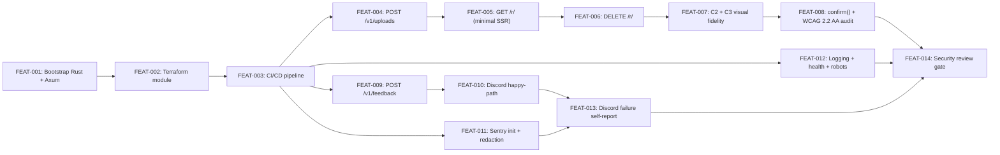

# MVP Intake Service

## Goal

Build the full MVP `fabro.report` intake service end-to-end on Rust + Docker + Fargate + Terraform + S3 + Route53 + Sentry + Discord webhook. Cover both intake types — the Report flow (capability-URL Debug Bundle uploads, SSR receipt page, delete) and the Feedback flow (fire-and-forget multipart submission, Discord notification, IP-for-abuse-protection only) — provisioned end-to-end via Terraform with a CI/CD pipeline. The first demoable slice is the full Report flow (upload → receipt page → delete) running against the deployed production service.

## Scope

**In scope:**

- **Report flow**: `POST /v1/uploads` (mint ID, write metadata sidecar, issue presigned PUT), `GET /r/<32-hex>` (SSR receipt page with C2/C3 visual fidelity), `DELETE /r/<32-hex>` (capability-URL-authorized delete).
- **Feedback flow**: `POST /v1/feedback` (multipart parse, UUIDv7, S3 writes, IP capture, Discord notification, failure-self-reporting per A17).
- **Operational topology**: VPC + subnets, ECS cluster + Fargate task, ALB + ACM TLS, Route53 record for `fabro.report`, ECR repo, single private S3 bucket with two prefix-scoped 30-day lifecycle rules, IAM task role with least-privilege, Secrets Manager entries for Sentry DSN + Discord webhook URL, Sentry init with redaction guard, structured JSON logging to CloudWatch, `/health` + `/robots.txt`.
- **Infrastructure as code**: Terraform module under `terraform/` consumed by a thin root config under `terraform/live/production/`. Production-only environment for MVP.
- **CI/CD**: GitHub Actions — `terraform plan` on PRs (no apply), build + push + apply + smoke-test on `main`.
- **Security review gate**: 14-item checklist validating the deployed system's security properties.

**Out of scope:**

- The four canonical CLI commands (`fabro dump`, `fabro dump --upload`, `fabro upload`, `fabro feedback`) — these live in the parent Fabro repo (`~/p/fabro-sh/fabro`) and ship in a separate plan. MVP testing uses `curl` or test scripts against the HTTP endpoints.
- Staging environment — production-only for MVP; staging is a follow-up plan.
- Per-IP rate limiting, metrics, tracing, multi-region — deliberately deferred per [[System - Service Topology]] and [[Decision - IP Logging for Abuse Protection]].
- Anything `bun.report`-shaped beyond intake + secret URL: no symbolication, no bundle rendering, no threading, no team dashboard, no submitter dashboard, no auth, no content dedup. Forbidden by [[Principle - Reject Like bun.report Drift]] and [[Principle - Narrow Forever]].
- A third intake type — locked at two forever per [[Principle - Narrow Forever]].

## Success Outcomes

| ID | Outcome | Tier | Tickets |
|----|---------|------|---------|
| O-1 | [Report flow works end-to-end on the deployed service](outcomes/O-1.md) | must | FEAT-004, FEAT-005, FEAT-006, FEAT-007, FEAT-008 |
| O-2 | [Feedback intake works end-to-end on the deployed service](outcomes/O-2.md) | must | FEAT-009, FEAT-010 |
| O-3 | [Service is provisioned on AWS via Terraform with zero ClickOps](outcomes/O-3.md) | must | FEAT-001, FEAT-002, FEAT-003, FEAT-014 |
| O-4 | [Service-error observability is wired up across both flows](outcomes/O-4.md) | should | FEAT-011, FEAT-012 |
| O-5 | [Discord webhook failure self-reporting works per A17](outcomes/O-5.md) | should | FEAT-013 |

## Context Summary

See [CONTEXT_BRIEFING.md](CONTEXT_BRIEFING.md) for the full briefing from Bridget — 8 primary cards, 17 supporting cards, 33 gaps surfaced, 48 anti-patterns flagged, 26 settled decisions cross-referenced.

**Primary cards driving the four planning surfaces:**

- **Stack & topology**: [[Decision - Service Stack]] pins Rust + Docker + Fargate + Route53 + Terraform + SSR HTML. [[System - Service Topology]] enumerates every operational piece (compute, DNS, IAM, secrets, Discord egress, Terraform).
- **Report flow**: [[Component - Report]] (the entity), [[System - Debug Bundle Retention, Storage, and Key Scheme]] (key scheme + 30-day lifecycle), [[Component - Report Metadata Page]] (the four-element rendered surface), [[Decision - Capability URLs over Auth]] (URL = view + delete authorization).
- **Feedback flow**: [[Component - Feedback]] (the entity, asymmetric to Report), [[System - Feedback Storage & Notification]] (S3 layout + Discord push + failure self-reporting), [[Decision - Fire-and-Forget Feedback]] (no URL, no GET, no DELETE), [[Decision - IP Logging for Abuse Protection]] (IP scope ceiling).
- **CLI surface (server-side wire formats)**: [[Standard - Interaction Patterns (CLI + Delete)]] owns the upload architecture (presigned-PUT for bundles, direct multipart-POST for Feedback), the 50 MB cap, and the delete-confirmation contract. The CLI implementations themselves are out of scope per the planning decision.

**Load-bearing asymmetries:** Reports and Feedback have asymmetric ID shapes (32-hex CSPRNG vs UUIDv7), upload paths (presigned-S3-PUT vs direct POST), storage layouts (per-Report prefix with `bundle.tar.gz` + `metadata.json` vs per-Feedback prefix with `feedback.json` + `feedback.txt` + `attachments/...`), notification surfaces (none vs Discord), and post-submission affordances (capability URL + delete vs nothing). Conflating them is the most-named anti-pattern in the library; ticket descriptions reference the relevant guard-rail cards.

## Decisions Made During Planning

| Decision | Options Considered | Chosen | Rationale |
|----------|-------------------|--------|-----------|
| CLI work scope | (a) bundle CLI tickets in this plan; (b) thin enabler for end-to-end demo; (c) service-only plan | Service-only plan | CLI lives in a different repo with different ownership; coupling them slows both. Demo via `curl` is acceptable for MVP. |
| CLI naming | `fabro report` (goal-statement spelling, superseded) vs canonical `fabro dump` / `fabro upload` / `fabro feedback` | Canonical names | The library's [[Standard - Noun Vocabulary]] supersedes the `fabro report` name as of 2026-04-23; honor the library. |
| Terraform location | (a) in this repo; (b) separate `fabro-report-infra` repo | In `terraform/` directory of this repo, structured as a module | Single repo simplifies PR review and keeps app + infra commits paired. |
| Terraform structure | (a) monolithic root; (b) reusable module + thin root | Module under `terraform/` consumed by `terraform/live/production/` | "Make this a Terraform module" per planning conversation; sets up future staging/prod consumers cheaply. |
| Environments in MVP | (a) production only; (b) staging + production | Production only | Smaller MVP scope; staging can be added in a follow-up plan as a second root config consuming the same module. |
| Wire format for `POST /v1/feedback` | (a) multipart form; (b) JSON envelope with base64 attachments | Multipart form | Standard for file uploads, easy to test with curl, no base64 size overhead. Per Bridget's recommendation. |
| Report upload atomicity | (a) sidecar BEFORE presigned PUT (orphans cleaned by lifecycle); (b) sidecar AFTER PUT via completion-callback endpoint | Sidecar BEFORE PUT | Simpler MVP. Orphan metadata expires via 30-day lifecycle. Page handler does HEAD on bundle to detect orphans → 404. |
| Sidecar storage location | (a) date-partitioned only (`<YYYY>/<MM>/<DD>/<id>/metadata.json`); (b) flat keyspace (`r/<id>.json`) | Flat keyspace `r/<id>.json` | Page handler can do single `GetObject` lookup from URL ID; date partitioning preserved for the bundle so Triagers can browse by date. Refines [[System - Debug Bundle Retention, Storage, and Key Scheme]] — captured in library-updates.md. |
| Rust web framework | Axum vs Actix vs Rocket | Axum | Consistent with parent `fabro-server` per [[Decision - Service Stack]]. |
| AWS SDK | `aws-sdk-s3` (official) vs `rusoto` | `aws-sdk-s3` | Official, maintained, modern async API. |
| UUIDv7 source | `uuid` crate v7 feature vs `uuid7` crate | `uuid` crate with `v7` feature | Maintained, single dependency for both v4 and v7 if needed elsewhere. |
| CSPRNG source for Report IDs | `OsRng` vs `getrandom` | `rand::rngs::OsRng` | Standard pattern, reads from OS entropy source. |
| Sentry crate | `sentry` (official) | `sentry` | Official Rust SDK with `tracing` and `panic` integrations. |
| Presigned PUT URL TTL | 5 min vs 15 min vs 1 hour | 15 minutes | Long enough for a slow upload near the 50 MB cap, short enough to bound the upload window. |
| Feedback request body cap | 25 MiB vs 50 MiB vs unbounded | 25 MiB | Sized to Discord's webhook attachment ceiling (~25 MB typical) so we don't accept Feedback that can't be notified. |
| Delete confirmation UI | Native `confirm()` vs custom modal | Native `confirm()` | Accessible by default (focus, ESC, focus return). Per [[Standard - Interaction Patterns (CLI + Delete)]] both are acceptable; native is the simpler choice for MVP. |
| Receipt page timestamp format | ISO 8601 UTC vs locale-relative | ISO 8601 UTC | Per [[Standard - Receipt Page Sketch]] default. |
| Receipt page size format | Decimal `2.3 MB` vs binary `2.2 MiB` | Decimal `2.3 MB` | Per [[Standard - Receipt Page Sketch]] default; matches Reporter mental model. |
| HTTP error response format | JSON envelope vs plain text vs RFC 7807 | JSON envelope `{ "error": { "message", "code" } }` | Machine-readable for CLI parsing, human-readable in the calm tone register. |
| CI/CD platform | GitHub Actions vs CircleCI vs none | GitHub Actions | Per [[Decision - Service Stack]]'s "GitHub Actions assumed" deferral; consistent with Fabro's existing pattern. |
| AWS credentials in CI | Static keys vs OIDC federation | OIDC federation | No long-lived secrets in repo; AWS recommended pattern. |
| Region | `us-east-1` (default) | `us-east-1` | Per [[System - Service Topology]] default. Single-region. |
| `robots.txt` | Allow all vs `Disallow: /` | `Disallow: /` | Capability URLs must not be indexed; belt-and-suspenders with page-level `<meta name="robots">`. |

## Risks and Assumptions

| Type | Description | Mitigation | Tickets Affected |
|------|-------------|-----------|-----------------|
| Risk | MVP cannot be tested by real Reporters until the CLI ships in the parent Fabro repo's plan. | Test scripts (`curl`-based) cover the HTTP surface. Ship the CLI plan in parallel. | All |
| Risk | The 50 MB hard cap may be too small for real Fabro debug bundles encountered in the field. | Document the cap clearly in the CLI's error path (when CLI ships); escalate to product owner if exceeded; do not unilaterally raise. | FEAT-004 |
| Risk | Discord webhook URL is the sole authentication on the notification target; URL leak = bad actor can spam Discord. | Store only in Secrets Manager; rotate quarterly; document rotation procedure (FEAT-014 item 13). | FEAT-002, FEAT-010 |
| Risk | Sidecar-before-PUT creates orphan metadata for failed uploads, lasting until the 30-day lifecycle expires. | Page handler does HEAD on bundle → 404 if missing. S3 cost of orphan metadata is negligible (small JSON files). Documented in code. | FEAT-004, FEAT-005 |
| Risk | Production-only environment means changes go straight to production. | GitHub Actions runs `terraform plan` on PRs for review; deploy workflow runs smoke test post-apply; consider manual approval gate on `terraform apply` if comfort level requires. | FEAT-003 |
| Risk | The receipt page's flat-keyspace sidecar (`r/<id>.json`) is a refinement to [[System - Debug Bundle Retention, Storage, and Key Scheme]] introduced during planning. The library card needs an update. | Captured in library-updates.md; Conan/Sam will update the card before O-1 closes. | FEAT-005 |
| Assumption | An AWS account exists and has been chosen (qlty-cloud sub-account, infra-production, or a new fabro-report account). | Confirm with product owner before FEAT-002 begins. | FEAT-002 |
| Assumption | The `fabro.report` domain is registered in Route53 (or registrable). | Verify before FEAT-002; manual registration if needed via the AWS console (one-time, not automated). | FEAT-002 |
| Assumption | A Discord channel + webhook URL has been created out-of-Terraform; the URL is provided as input to populate the secret. | Confirm with product owner before FEAT-010. | FEAT-002, FEAT-010 |
| Assumption | A Sentry account/project for `fabro.report` exists; the DSN is provided as input. | Confirm with product owner before FEAT-011. | FEAT-002, FEAT-011 |

## Execution Phases

**The first demoable milestone is Phase 6** — after FEAT-006, the Report flow runs end-to-end on the deployed production service (upload via presigned PUT, receipt page renders the four elements, delete works). Phase 7 + 8 polish the page to the C2/C3/A8 bar. The CLI for the headline Reporter experience ships in a separate plan, so the Phase 6 demo uses `curl`-based test scripts.

```
Phase 1 (foundation): FEAT-001
Phase 2 (infrastructure): FEAT-002
Phase 3 (deploy gate): FEAT-003 — empty service deployed at fabro.report
Phase 4 (handlers + observability foundation, parallel): FEAT-004, FEAT-009, FEAT-011, FEAT-012
Phase 5 (downstream integrations, parallel): FEAT-005, FEAT-010
Phase 6 (closing the flows): FEAT-006, FEAT-013 — Report flow demoable end-to-end
Phase 7 (visual fidelity): FEAT-007
Phase 8 (a11y + delete UX): FEAT-008 — O-1 fully validates
Phase 9 (security gate): FEAT-014 — O-3 validates
```



**Critical path:** FEAT-001 → FEAT-002 → FEAT-003 → FEAT-004 → FEAT-005 → FEAT-006 → FEAT-007 → FEAT-008 → FEAT-014 (9 tickets).

## Re-planning Triggers

- **AWS account / domain / Discord webhook / Sentry project not confirmed before FEAT-002** — pause and escalate to product owner; some Terraform inputs are unknowable until these are confirmed.
- **Real-world bundle size exceeds 50 MB cap during testing** — escalate to product owner; the cap is library-pinned and changing it requires updating [[Standard - Interaction Patterns (CLI + Delete)]] first.
- **Discord component-v2 schema rejected by the webhook** — fall back to legacy embed format; document the fallback in code with a TODO to re-attempt component-v2 when the webhook supports it.
- **Sidecar-before-PUT atomicity creates problems Bridget did not anticipate** (e.g., the orphan-metadata cost is non-negligible at expected volume; the HEAD-on-bundle approach has latency that violates calm UX) — re-plan FEAT-004 and FEAT-005 with the completion-callback approach.
- **Security review (FEAT-014) finds blocking issues** — open follow-up tickets and block O-3 closure until they resolve.

## Ticket Index

| ID | Title | Enabler | Tier | Outcome | Blocked By | Blocks |
|----|-------|---------|------|---------|------------|--------|
| FEAT-001 | Bootstrap Rust + Axum service with /health endpoint and Dockerfile | false | must | O-3 | — | FEAT-002 |
| FEAT-002 | Terraform module: complete production infrastructure for fabro.report | false | must | O-3 | FEAT-001 | FEAT-003 |
| FEAT-003 | GitHub Actions: build → ECR → terraform apply pipeline with PR plan gate | false | must | O-3 | FEAT-002 | FEAT-004, FEAT-009, FEAT-011, FEAT-012 |
| FEAT-004 | POST /v1/uploads: mint Report ID, write metadata sidecar, issue presigned PUT | false | must | O-1 | FEAT-003 | FEAT-005 |
| FEAT-005 | GET /r/<id>: render minimal SSR Report Metadata Page with the four elements | false | must | O-1 | FEAT-004 | FEAT-006 |
| FEAT-006 | DELETE /r/<id>: remove all Report S3 objects, capability URL becomes 404 | false | must | O-1 | FEAT-005 | FEAT-007 |
| FEAT-007 | Apply C2 design system + C3 layout to Report Metadata Page | false | must | O-1 | FEAT-006 | FEAT-008 |
| FEAT-008 | Native confirm() delete flow + WCAG 2.2 AA accessibility audit | false | must | O-1 | FEAT-007 | FEAT-014 |
| FEAT-009 | POST /v1/feedback: multipart parse, UUIDv7, S3 writes, IP capture | false | must | O-2 | FEAT-003 | FEAT-010 |
| FEAT-010 | Discord webhook component-v2 payload + happy-path POST after S3 writes | false | must | O-2 | FEAT-009 | FEAT-013 |
| FEAT-011 | Sentry init at startup with redaction guard against payload bytes | false | should | O-4 | FEAT-003 | FEAT-013 |
| FEAT-012 | Structured JSON logging, healthcheck refinement, robots.txt | false | should | O-4 | FEAT-003 | FEAT-014 |
| FEAT-013 | Discord failure self-reporting: second call + Sentry escape on second failure | false | should | O-5 | FEAT-010, FEAT-011 | FEAT-014 |
| FEAT-014 | Security review checklist: validate the deployed system's security properties | false | must | O-3 | FEAT-008, FEAT-012, FEAT-013 | — |

## Library Updates

See [library-updates.md](library-updates.md). Five card updates are implied by this plan: one refinement to a System card (flat-keyspace sidecar), three new Decision cards (multipart wire format, sidecar-before-PUT atomicity, Terraform module layout), and a WHEN-section update across the eight primary cards to record the planned MVP build.

## Deferred

(Populated by `/ax-complete-plan` after execution.)
